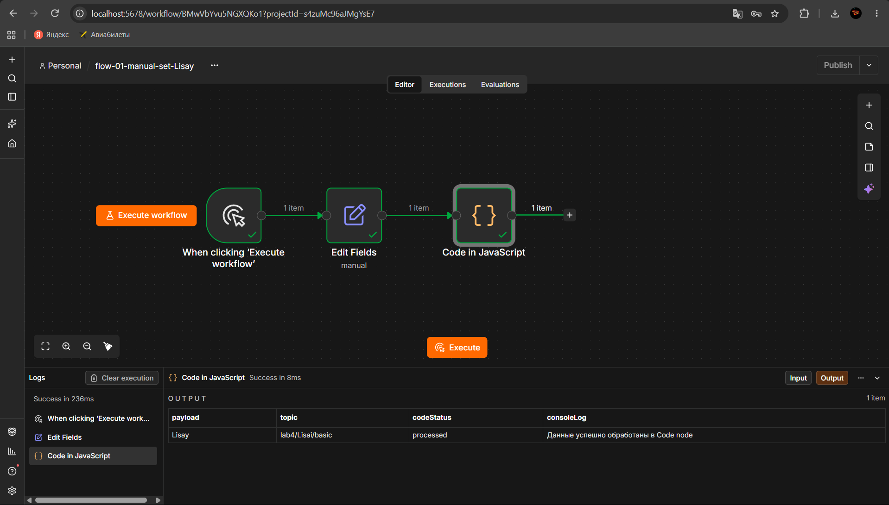
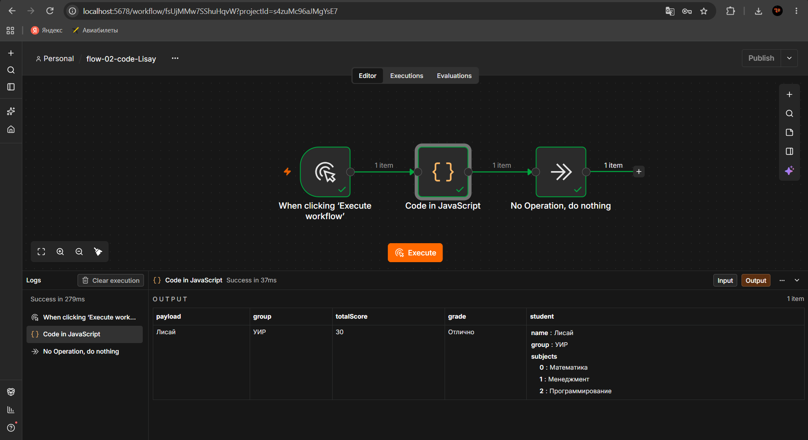
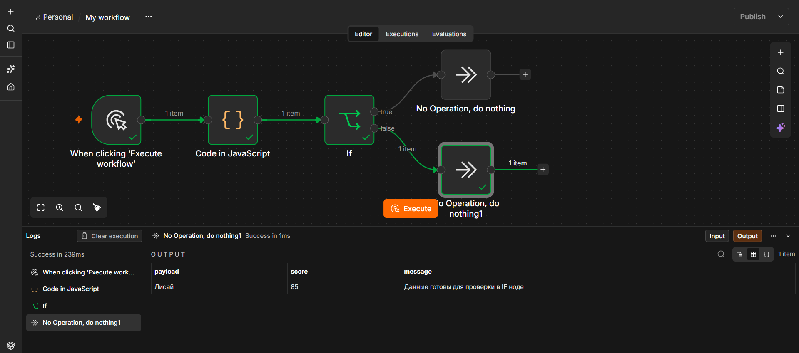
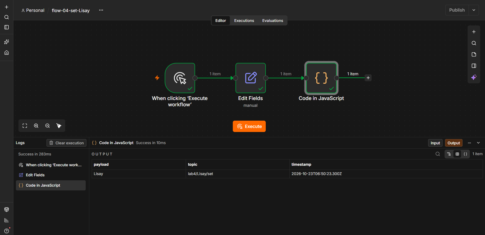
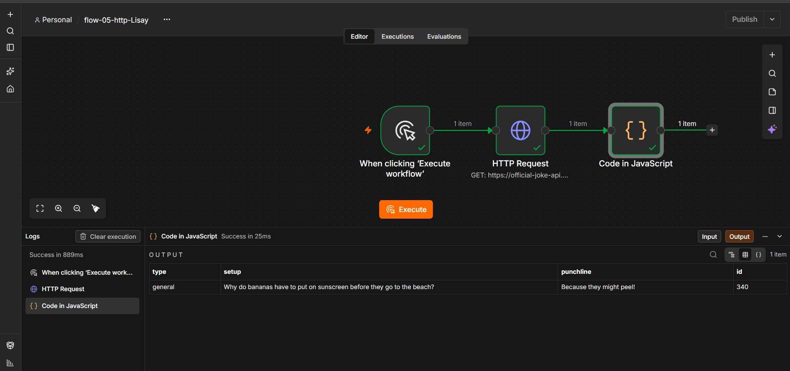
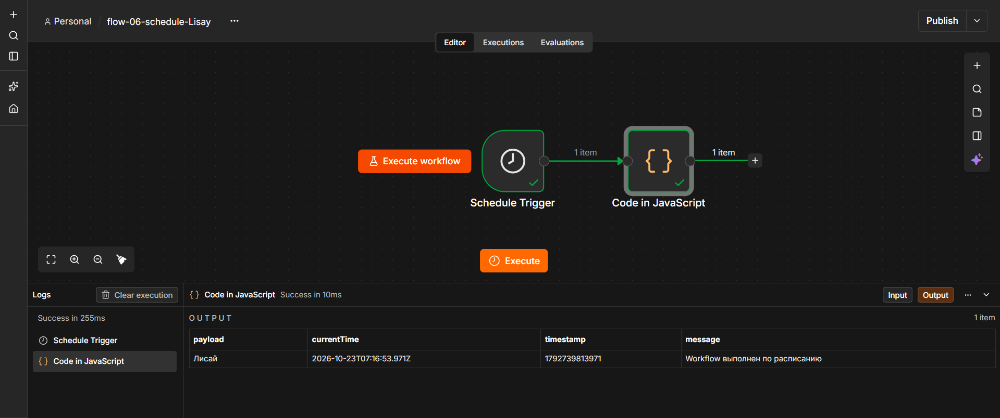
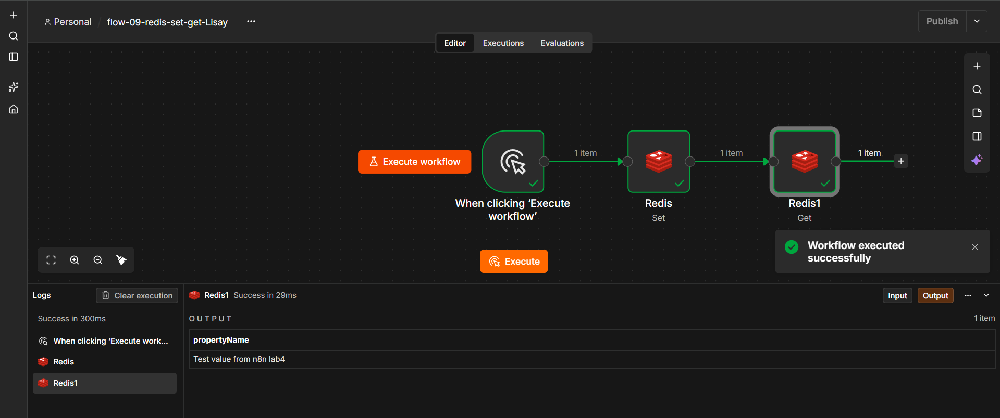
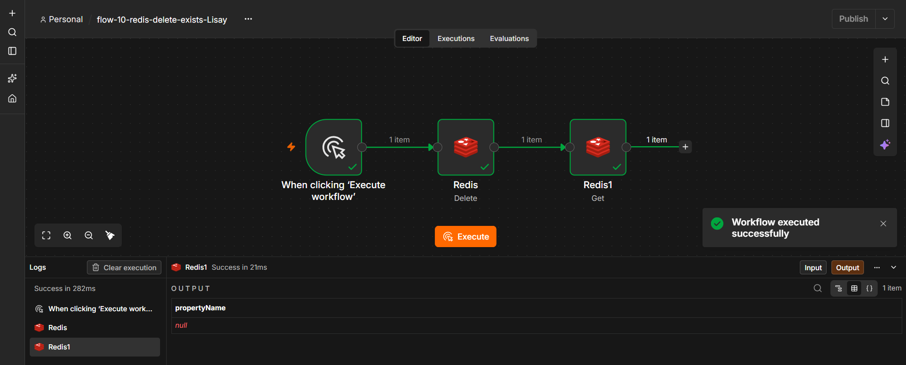
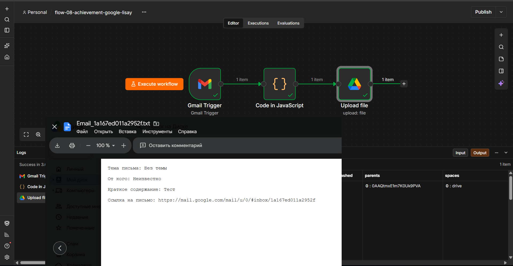

# Отчёт по лабораторной работе №4: n8n
---

## 1. Краткое описание выполненного

В ходе лабораторной работы была установлена и настроена low-code платформа n8n через Docker. Изучены базовые ноды (Manual Trigger, Set, Code, IF, HTTP Request, Schedule Trigger), настроена интеграция с Redis для работы с ключами, реализована ачивка 8.2 — автоматическое создание текстового файла на Google Drive при получении нового письма в Gmail.

---

## 2. AI-промпты, использованные в работе

- "Как запустить n8n через Docker Desktop GUI, какие volumes и порты указать?"
- "Напиши JavaScript код для n8n Code node, который преобразует JSON из Gmail в бинарный файл для Google Drive с кодировкой base64, поддерживающий кириллицу."
- "Как настроить OAuth2 credentials для Gmail и Google Drive API в Google Cloud Console для localhost?"
- "Ошибка в n8n Upload file: 'The first argument must be of type string or an instance of Buffer. Received undefined' — как исправить?"

---

## 3. Освоенные ноды

**Triggers:** Manual Trigger, Schedule Trigger, Gmail Trigger  
**Core:** Set (Edit Fields), Code, IF, NoOp  
**Actions:** HTTP Request, Google Drive (Upload file), Redis (Set, Get, Delete, Exists)

---

## 4. Скриншоты workflow

### 4.1. Установка n8n
### 4.2. Manual Trigger → Set → Code

### 4.3. Code node с JS-конструкциями

### 4.4. IF node с ветвлением

### 4.5. Set с timestamp

### 4.6. HTTP Request к joke API

### 4.7. Schedule Trigger

### 4.8. Redis: создание и чтение ключа

### 4.9. Redis: удаление и проверка ключа

### 4.10. Ачивка 8.2: Gmail → Google Drive

---

## 5. Выводы

В ходе работы я научился разворачивать n8n в Docker-контейнере и настраивать взаимодействие между различными сервисами. Особую ценность представляла работа с OAuth2 авторизацией Google API и преобразованием данных между JSON и бинарным форматом в ноде Code. Интеграция с Redis показала, как можно использовать внешнее хранилище для управления состоянием между запусками workflow. Платформа n8n демонстрирует мощные возможности для автоматизации рутинных задач без написания большого объёма кода.