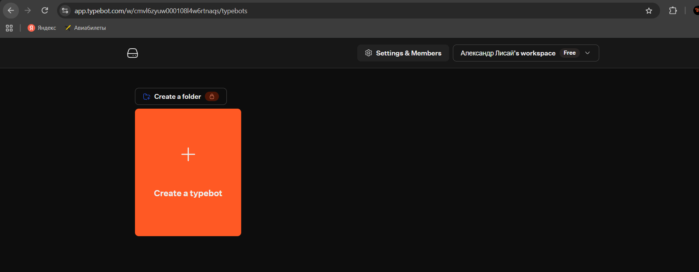
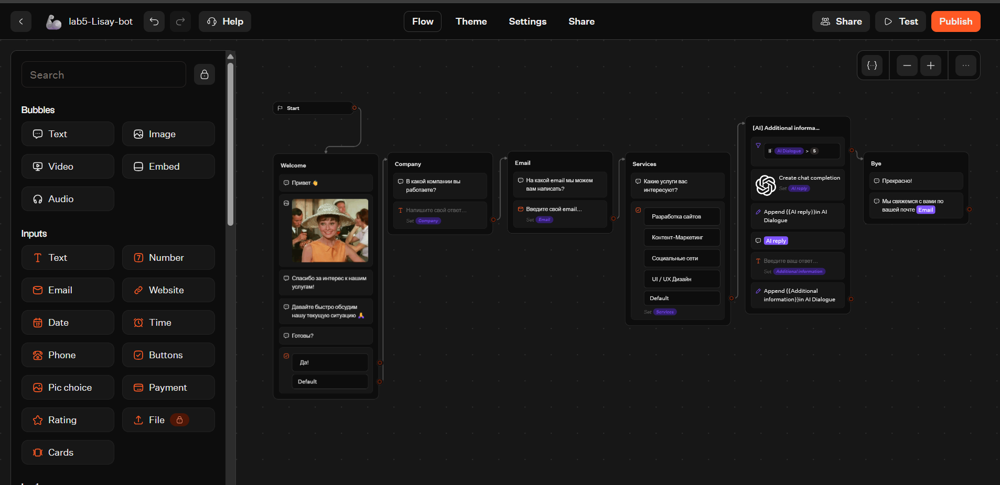
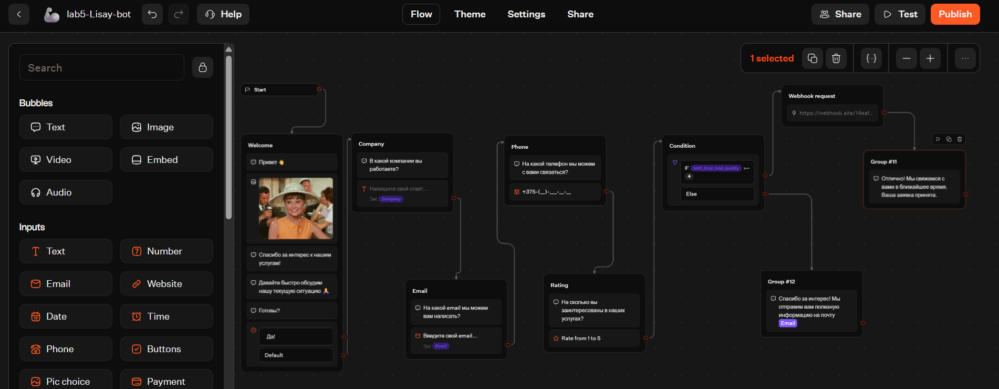
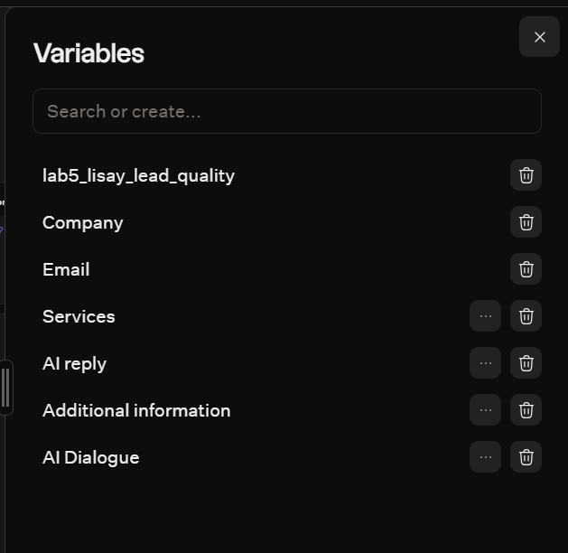
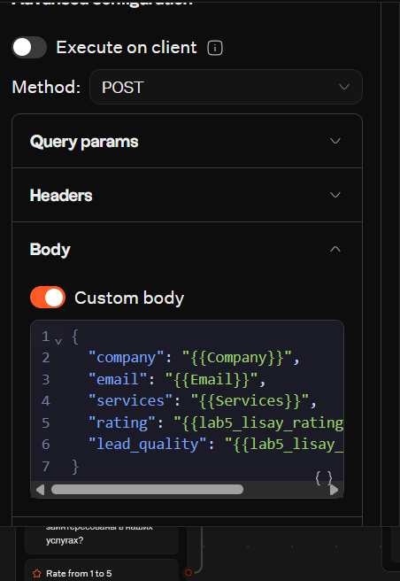
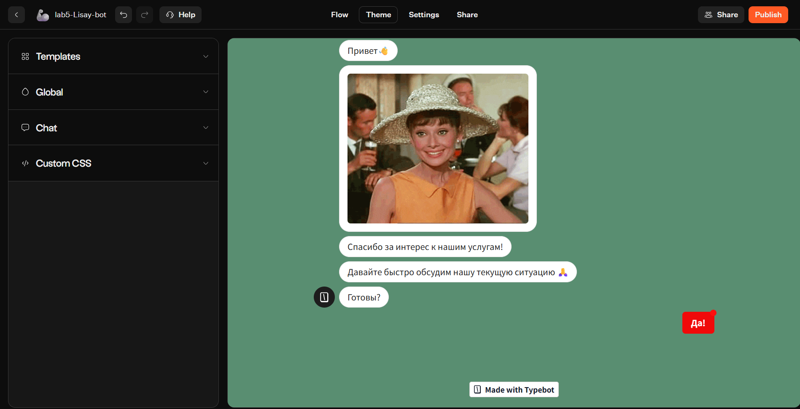
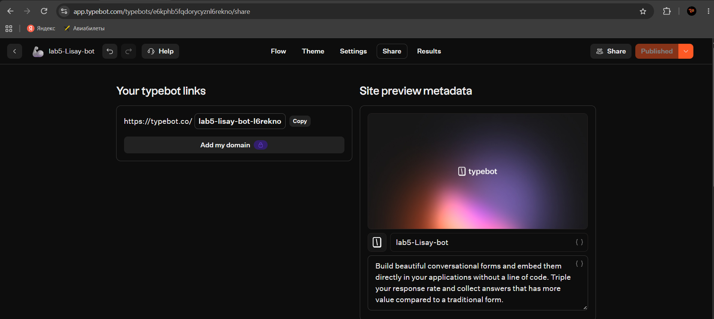

# Отчёт по Лабораторной работе №5. Чат-боты 
**Выбранный трек:** C. TypeBot

## 1. Описание выбранного трека и ссылка на бота
В ходе работы был выбран трек TypeBot, так как эта low-code платформа отлично подходит для визуального проектирования интерактивных форм, опросников и сценариев сбора лидов.  
**Ссылка на опубликованного бота:** https://typebot.co/lab5-lisay-bot-l6rekno

## 2. Использование ИИ (Промпты)
ИИ использовался для ускорения рутинных задач и генерации структур. Примеры промптов:
1. *"Переведи следующие тексты интерфейса чат-бота на русский язык, сохраняя дружелюбный и профессиональный тон: [список английских фраз]."*
2. *"Составь корректный JSON-объект для отправки через HTTP Request (Webhook), который будет включать переменные: компания, email, телефон, выбранные услуги и оценка клиента."*
3. *"Придумай 2 варианта текста для ветки условия: если клиент поставил высокую оценку (4-5), и если оценку низкую (1-3)."*

## 3. Освоенные блоки и элементы
В ходе работы я научился настраивать следующие элементы TypeBot:
* **Input blocks:** Text, Phone, Rating (сбор данных и сохранение в переменные).
* **Logic blocks:** Condition (разветвление сценария в зависимости от значения переменной `lab5_lisay_rating`).
* **Variables:** Создание кастомных переменных (`lab5_lisay_lead_quality`) и их динамическая подстановка в текст через `{{}}`.
* **Integrations:** Настройка HTTP Request (Webhook) для отправки собранных данных в формате JSON на внешний сервис (webhook.site).
* **Theme:** Кастомизация внешнего вида (цвета, шрифты, скругления).

## 4. Скриншоты workflow и диалогов
*(Ниже представлены скриншоты из папки screenshots)*

**Рис 1.** Регистрация и выбор шаблона  

**Рис 2.** Русифицированный flow (общий вид)  

**Рис 3.** Добавление новых блоков (Phone, Rating)  

**Рис 4.** Настройка переменной и условия (Condition)  

**Рис 5.** Настройка HTTP Request (Webhook) с JSON-пейлоадом  

**Рис 6.** Изменение темы и брендинга  

**Рис 7.** Результат публикации и ссылка  

## 5. Выводы
В ходе выполнения лабораторной работы я освоил платформу TypeBot. Главным открытием стало то, насколько наглядно можно проектировать сложную логику с помощью нод и стрелок, не написав ни строчки кода. Я научился работать с переменными, динамически подставлять их в сообщения, разветвлять сценарий с помощью условий и передавать данные во внешние системы через Webhook. 

**Ограничения бесплатного тарифа TypeBot:** ограничение на количество просмотров (views) в месяц, отсутствие некоторых продвинутых интеграций (например, нативная отправка Email без сторонних сервисов) и брендинг TypeBot в бесплатной версии.