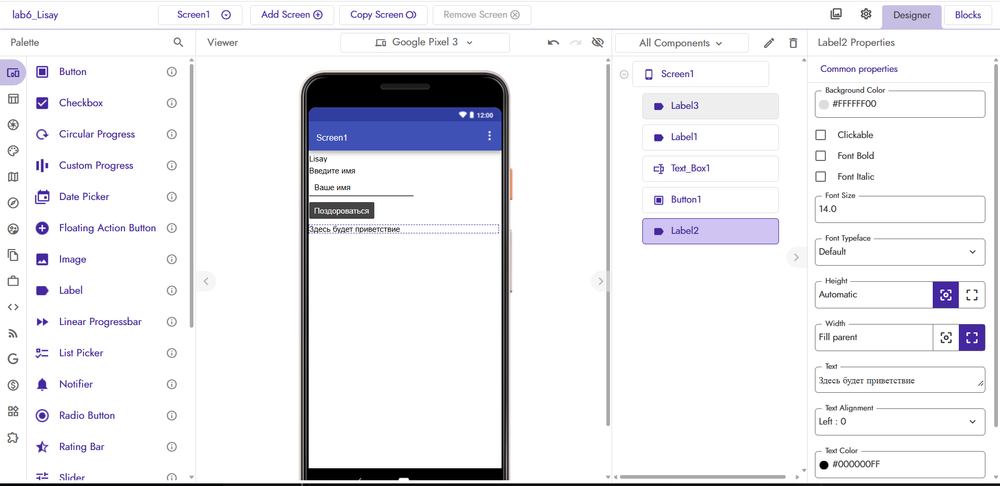
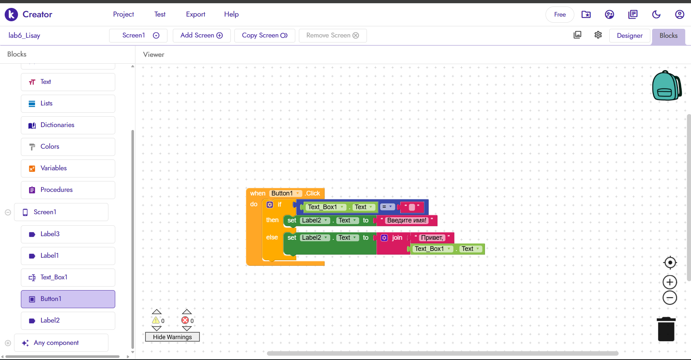
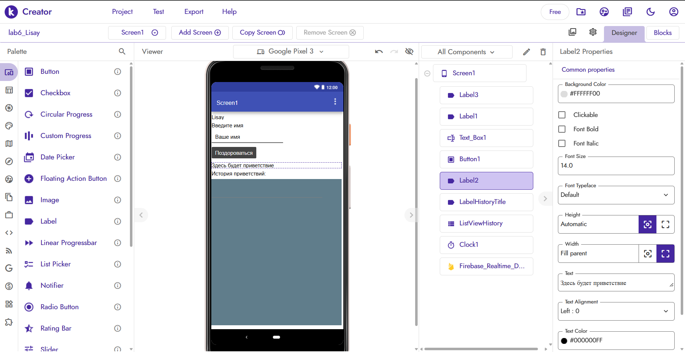
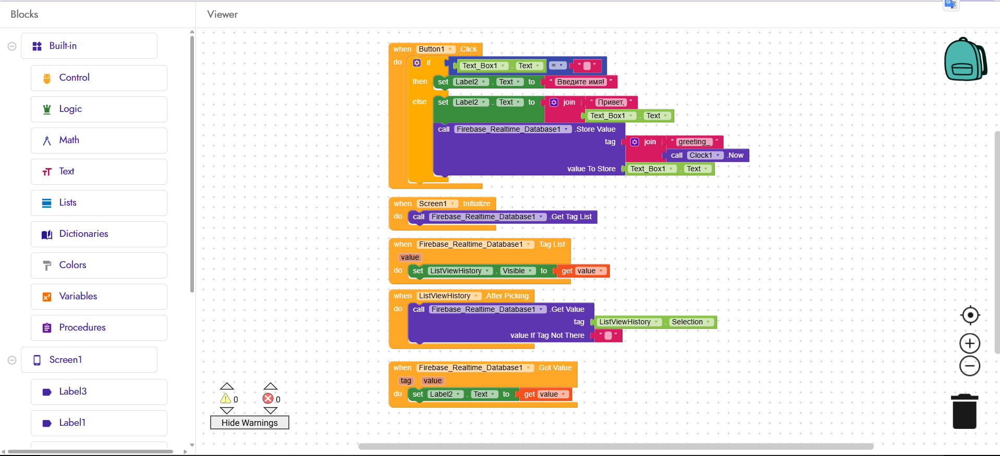

# Отчёт по лабораторной работе №6. Kodular 

## 1. Описание базового приложения
Реализовано приложение «Приветствие». На экране Screen1 расположены:
- Label с заголовком «Введите имя»;
- TextBox с подсказкой «Ваше имя»;
- Button «Поздороваться»;
- Label для вывода результата;
- Label с фамилией студента (Lisay) — виден на экране при запуске.

Логика работы кнопки: при нажатии проверяется, пуст ли TextBox. Если поле пустое — выводится «Введите имя!», иначе формируется приветствие «Привет, <имя>!» с использованием блока `join`. Использованы условный блок `if/else` и блок соединения строк `join`.

## 2. Реализованные ачивки

### Ачивка 4: Firebase Realtime Database
Реализована облачная история приветствий. При нажатии кнопки «Поздороваться» имя пользователя сохраняется в Firebase Realtime Database с уникальным тегом, сформированным как `join "greeting_" (get Clock1.Now)`. При запуске экрана (`Screen1.Initialize`) вызывается `GetTags`, а в обработчике события `Tag List` полученные теги передаются в `ListView.Elements` для отображения на экране. Дополнительно реализован просмотр конкретной записи: при клике на элемент списка вызывается `GetValue` по выбранному тегу, а результат отображается в обработчике `Got Value`.

Использованные компоненты: `Firebase_Realtime_Database`, `ListView`, `Clock`, `Label`, `TextBox`, `Button`.  
Использованные блоки: `if/else`, `join`, `StoreValue`, `GetTags`, `Tag List`, `GetValue`, `Got Value`, `Clock1.Now`, `ListView.Elements`, `ListView.Selection`.

## 3. Файлы проекта
- Экспорт базовой версии: `exports/lab6_Lisay_1.aia`
- Экспорт версии с Firebase: `exports/lab6_Lisay_2.aia`

## 4. Использование AI-промптов
В ходе работы использовались следующие запросы к ИИ:
1. «Как в Kodular сделать проверку текстового поля на пустоту и вывести разный текст в Label через if/else?»
2. «Какие блоки Clock использовать для формирования уникального тега в Firebase?»
3. «Как подключить Firebase Realtime Database в Kodular для хранения списка строк?»
4. «Как загрузить список тегов из Firebase и отобразить в ListView при старте экрана?»
5. «В чём разница между блоками Tag List и Got Value в Firebase Realtime Database Kodular?»

## 5. Освоенные компоненты и блоки
- **Компоненты**: Label, TextBox, Button, ListView, Clock, Firebase_Realtime_Database.
- **Блоки**: `if/else`, `join`, `StoreValue`, `GetTags`, `Tag List`, `GetValue`, `Got Value`, `Clock1.Now`, `ListView.Elements`, `ListView.AfterPicking`.

## 6. Ограничения бесплатного тарифа
В ходе работы столкнулся со следующими ограничениями бесплатного тарифа Kodular:
- Лимит на количество проектов (до 10) — требует удаления старых тестовых проектов перед созданием новых.
- Лимит на размер ассетов (до 10 МБ) — изображения нужно сжимать перед загрузкой.
- Лимит на количество расширений (до 5) — приходится тщательно выбирать необходимые инструменты.
- Публичный Firebase-сервер Kodular (`kodular-test.firebaseio.com`) иногда работает медленно или недоступен, что затрудняет отладку.
- При экспорте проекта в .aia файл может быть небольшим по размеру (3–4 КБ), если в проекте нет тяжёлых ассетов.

## 7. Выводы
В ходе лабораторной работы я освоил основы визуального программирования в Kodular. Научился создавать интерфейсы с базовыми компонентами (Label, TextBox, Button), описывать логику через блочную среду, работать с условными операторами и блоками соединения строк. Особый интерес вызвала работа с Firebase Realtime Database — удалось реализовать облачное хранение данных без написания кода, только через визуальные блоки. Платформа Kodular удобна для быстрого прототипирования мобильных приложений, но имеет разумные ограничения в бесплатной версии, которые нужно учитывать при разработке.

## 8. Скриншоты

### Базовое задание

### Ачивка 4: Firebase Realtime Database

